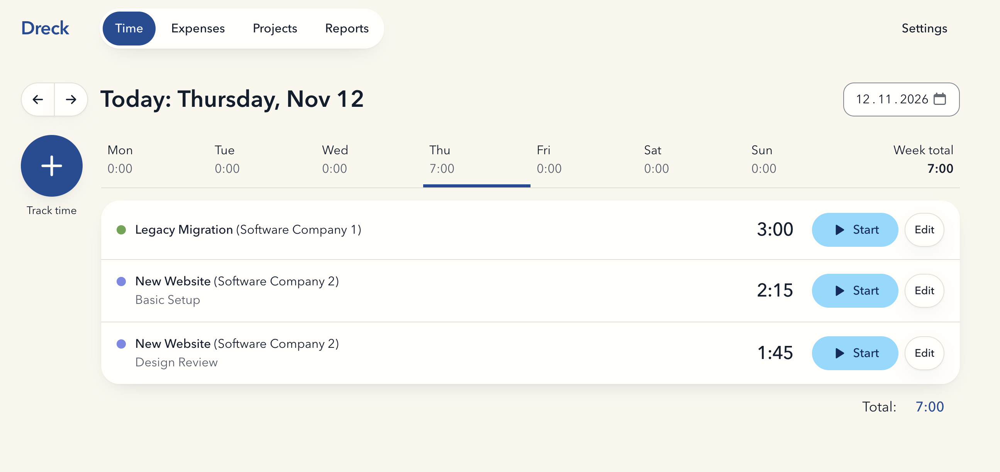
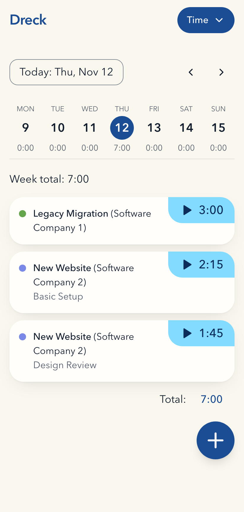

# Dreck

**Dreck** (German for “dirt”, and a slightly misspelled “track”) is a very simple time and expense tracker with invoicing for one person.

<p>
  
  
</p>

> Main branch is stable, but this repo is under development to add missing features like estimates.

## Quickstart

```sh
docker run -d --name dreck -p 127.0.0.1:3000:3000 -v dreck-data:/data ghcr.io/julianhandl/dreck
docker logs dreck
```

Open <http://localhost:3000> and paste the secret from the log as the password.

Remove it again with `docker rm -f dreck && docker volume rm dreck-data`.

## Documentation

- [Getting started](docs/getting-started.md): onboarding, settings, customers and projects, expenses, archiving
- [Tracking time](docs/time-tracking.md): time entries, the timer, forgotten timers, durations
- [Tasks](docs/tasks.md): default tasks, tasks per project, billable and own hourly rates
- [Hourly rates](docs/hourly-rates.md): how rates are copied, what changing a rate does, how amounts are calculated
- [Reports and rounding](docs/reports.md): rounding rules, report figures, CSV format
- [Invoicing](docs/invoicing.md): invoices from tracked time, locking, status, printing
- [Keyboard and gestures](docs/keyboard.md): shortcuts and touch gestures
- [Self-hosting](docs/self-hosting.md): configuration, own reverse proxy, several instances, Kubernetes

## Setup with Docker Compose

You need a server with Docker, a domain that points to it, and ports 80 and 443 open. Save this as `compose.yaml`:

```yaml
services:
  app:
    image: ghcr.io/julianhandl/dreck:latest
    restart: unless-stopped
    read_only: true
    environment:
      DRECK_SECRET: ${DRECK_SECRET:-}
    volumes:
      - dreck-data:/data

  caddy:
    image: caddy:2-alpine
    restart: unless-stopped
    command: caddy reverse-proxy --from ${DOMAIN:?Set DOMAIN in .env} --to app:3000
    ports:
      - "80:80"
      - "443:443"
      - "443:443/udp"
    volumes:
      - caddy-data:/data
    depends_on:
      - app

volumes:
  dreck-data:
  caddy-data:
```

Then start it:

```sh
echo "DOMAIN=dreck.example.com" > .env
docker compose up -d
docker compose logs app
```

Caddy fetches the HTTPS certificate for `DOMAIN` automatically. On the first start Dreck generates a secret and prints it once in the log. Open `https://<DOMAIN>` and paste it as the password.

## Update and rollback

```sh
docker compose pull && docker compose up -d
```

`latest` follows `main`. Releases are tagged `1.2.3`, `1.2` and `1`, every build also `sha-<short commit>`; see [Self-hosting](docs/self-hosting.md#image-tags).

Before Dreck applies database migrations it writes `backup-before-<last migration>.db` to the data volume and keeps the last three. There are no down migrations. To roll back: stop the container, copy that backup over `/data/dreck.db`, set the image in `compose.yaml` to the older `ghcr.io/julianhandl/dreck:sha-<commit>` and start it again. If the database is newer than the image, Dreck refuses to start and changes nothing.

## Backup and restore

- Download a backup under Settings, or with the API: `curl -H "Authorization: Bearer <secret>" -o dreck.db https://<DOMAIN>/api/v1/backup`.
- Or stop the container and copy the volume. Copying the file while Dreck runs is not safe.
- Restore only offline: `docker compose stop app`, replace `/data/dreck.db` in the `dreck-data` volume, `docker compose start app`.

## Secret

- Show it: `docker compose exec app cat /data/secret`
- Change it: delete `/data/secret` (`docker compose exec app rm /data/secret`) and restart. All sessions end.
- Or set your own with `DRECK_SECRET` in `.env` (at least 32 characters), or point `DRECK_SECRET_FILE` at a file; either takes precedence over `/data/secret`.

## API

Every endpoint is under `/api/v1` and accepts `Authorization: Bearer <secret>`. The OpenAPI description is at `/api/v1/openapi.json` and needs no authentication.

## License and security

Copyright (C) 2026 Julian Handl. Dreck is open source under the [GNU Affero General Public License v3.0](LICENSE). If you run a modified version as a network service, you must offer its source code to its users.

Report vulnerabilities privately, see [SECURITY.md](SECURITY.md).

### Trademark

"Dreck" and the Dreck icon are trademarks of Julian Handl. The AGPL covers the code, not the name: under section 7(e) of the license, no trademark rights are granted.

- Allowed: running Dreck under its name for yourself or your own company, and saying that your product is "based on Dreck".
- Not allowed without written permission: using "Dreck" or the icon as the name or logo of a fork, a hosted service or any product or service you offer to others.

If you publish a fork or offer it as a service, rename it and replace the icon.
