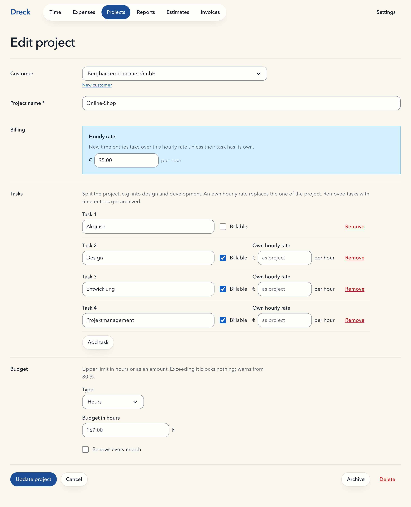
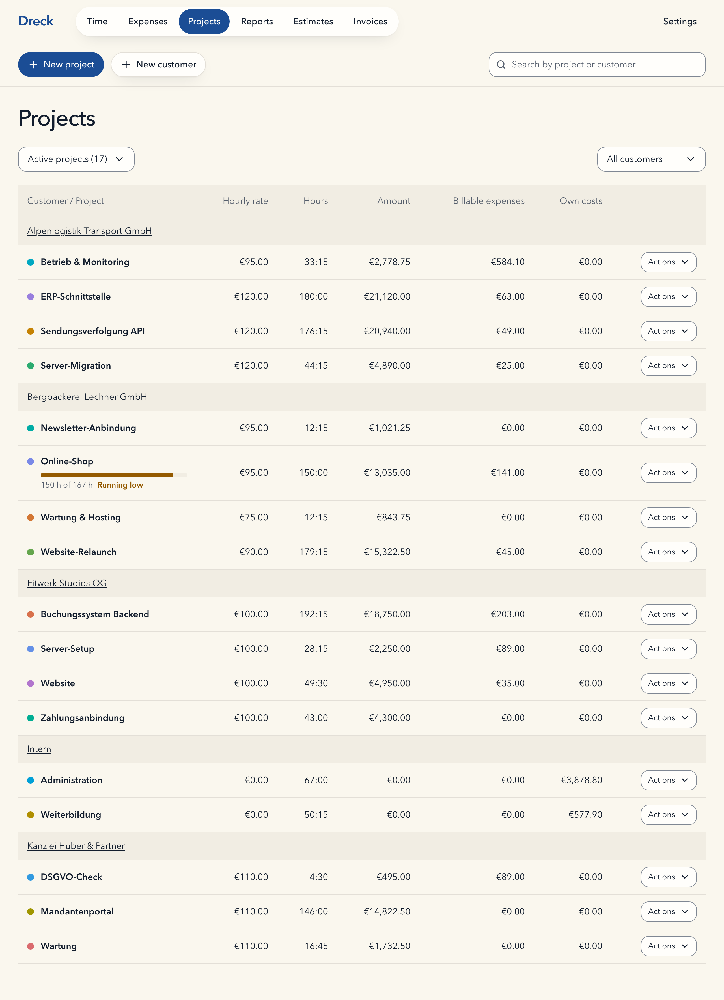

# Budgets

A budget is an upper limit for a project, in hours or as an amount. It fits fixed-price projects and hour contingents, for the whole project or for every month. Dreck shows how much is used up and warns when it gets tight. A budget blocks nothing: you can keep tracking after it is used up.

## Setting a budget

**Edit project → Budget**:

- **Type:** *No budget*, *Hours* or *Amount*. A project has at most one budget, and there is no budget per task.
- **Limit:** hours as `40:00` or decimal (`12,5`), an amount like any other amount. It must be greater than 0.
- **Renews every month:** the budget counts per calendar month instead of for the whole project. The month is the current month in the time zone of the instance; earlier months are not shown (the [report](reports.md) shows whether one was exceeded).
- **Include billable expenses** (amount only): billable expenses count towards the budget. Your own costs never do.

## What counts

- **Hours:** all hours after [rounding](reports.md), billable and non-billable.
- **Amount:** the amount of the billable time, plus billable expenses if chosen.
- A running timer counts up to now. Whether time is invoiced does not matter; archived tasks count.

## Where it shows

The **Projects** list shows a bar and *12,5 h of 40 h* below each project with a budget, monthly ones with *in November*. The project page has a **Budget** card with the rest, or *+3,5 h over budget*.

- **On track:** below 80 %.
- **Running low:** from 80 %, including exactly 100 %.
- **Exceeded:** above 100 %.

The state is always written out, not only coloured.

