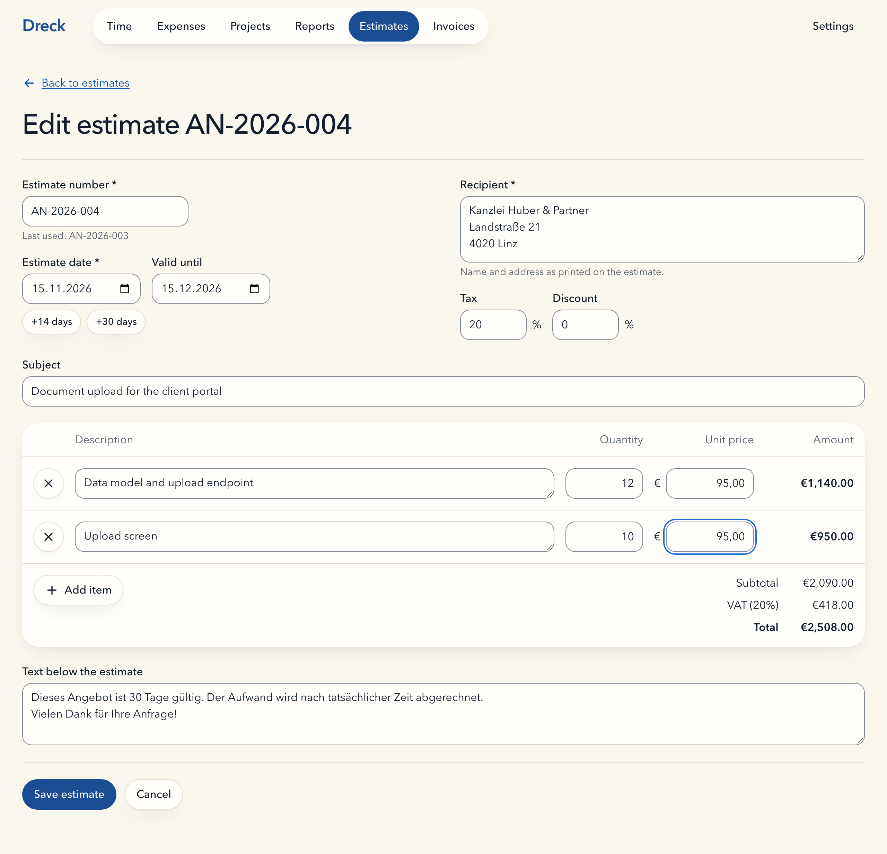
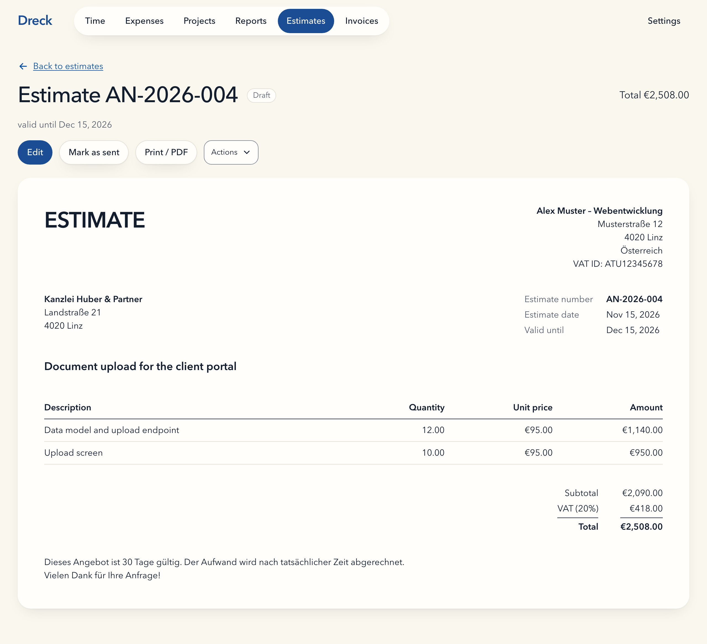
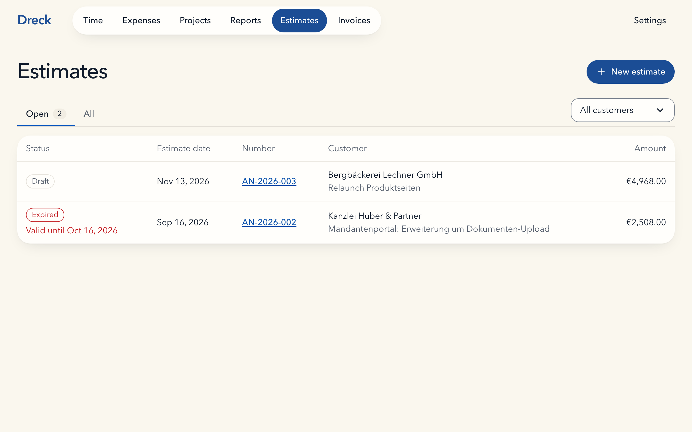

# Estimates

An estimate looks like an invoice, titled "Estimate" (German: "Angebot"), and is always written by hand: it has free items, no link to projects and no tracked time.

## Before the first estimate

- **Settings → Invoices:** your name, address and VAT ID are the same sender as on invoices. The **text below the estimate** (terms, validity, …) is copied into each new estimate. It is separate from the text below the invoice, so bank details do not end up on an estimate.
- **Customer:** the estimate is addressed to a customer. For a prospect, create a customer and archive it later. A customer with estimates cannot be deleted, only archived.

Sender data is read live. Recipient, tax and notes are copied when the estimate is created and stay as they are.

## Creating an estimate

**Estimates → New estimate**, pick the customer and **Create estimate**. Dreck creates a draft right away, numbered after the last estimate (`AN-2026-004` → `AN-2026-005`, the first is `1`), dated today and valid for 30 days, and opens it for editing. Estimate numbers have their own sequence: an estimate may have the same number as an invoice.

## Editing

Number, recipient, estimate date, valid until, subject, tax, discount, items and the text below the estimate can be changed while the estimate is a draft. **+14 days** and **+30 days** set "Valid until" relative to the estimate date; an empty field means no end date. Totals are calculated as for [invoices](invoicing.md#editing-a-draft).

## Status

| Status | Meaning |
|---|---|
| **Draft** | Can be changed. |
| **Sent** | Marked as sent. Content is locked. |
| **Expired** | Sent and past "valid until". Only a display, not a status of its own. |
| **Accepted** | The customer accepted. Content is locked. |
| **Declined** | The customer declined. Content is locked. |

The buttons on the estimate depend on the status: **Edit** and **Mark as sent** on a draft, **Accepted** and **Declined** on a sent one. **Back to sent** and **Back to draft** are in Actions and unlock the content again. The date of each step is always today. An estimate can be deleted in any status, after a confirmation. Dreck does not send emails; "Mark as sent" only records the date.

## Create invoice

**Create invoice** (a button on an accepted estimate, otherwise in Actions) creates a draft invoice for the same customer with the recipient, subject, tax, discount and items of the estimate, dated today and due in 14 days, and opens it for editing. The invoice number and the text below the invoice follow the usual rules for new invoices. There is no link between the two: the estimate stays unchanged and can be turned into an invoice more than once.

## PDF and printing

**Print / PDF** works as for [invoices](invoicing.md#pdf-and-printing). The suggested file name is "Angebot <number>" (in German).

## Overview

Tabs **Open** (drafts and sent estimates, including expired ones) and **All**, filter by customer. Tab and filter are part of the URL. A sent estimate shows "Valid until <date>" under its status, in red once expired.

## API

`GET /api/v1/estimates`, `POST /api/v1/estimates`, `PATCH /api/v1/estimates/:id`, `DELETE /api/v1/estimates/:id`. Content changes of a sent, accepted or declined estimate are refused with `409 estimate_locked` unless the same call turns it back into a draft (`sentOn`, `acceptedOn` and `declinedOn` all `null`). `acceptedOn` and `declinedOn` together are refused with `400`. Amounts are in minor units, quantities in hundredths, tax and discount in basis points (2000 = 20 %). See `/api/v1/openapi.json`.
