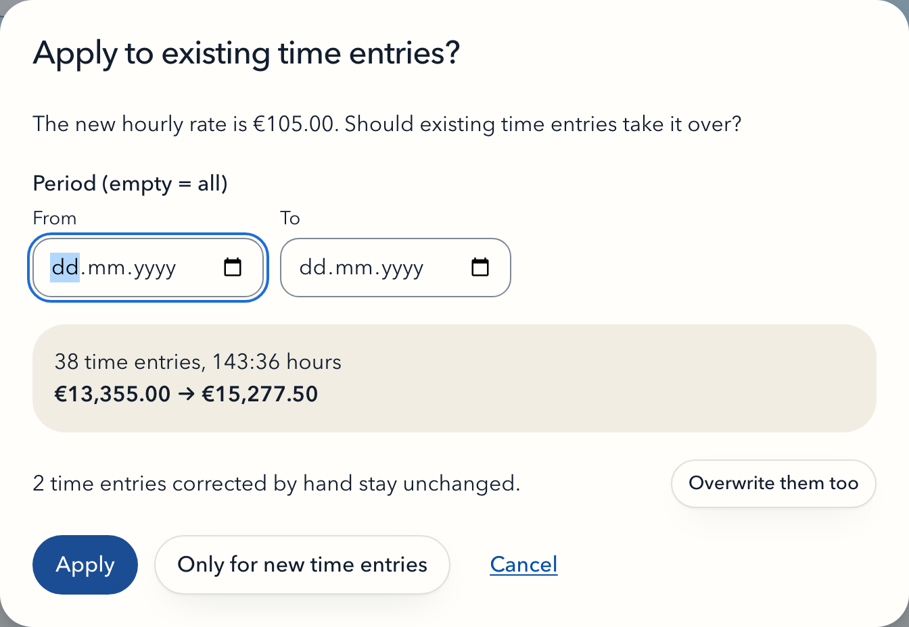
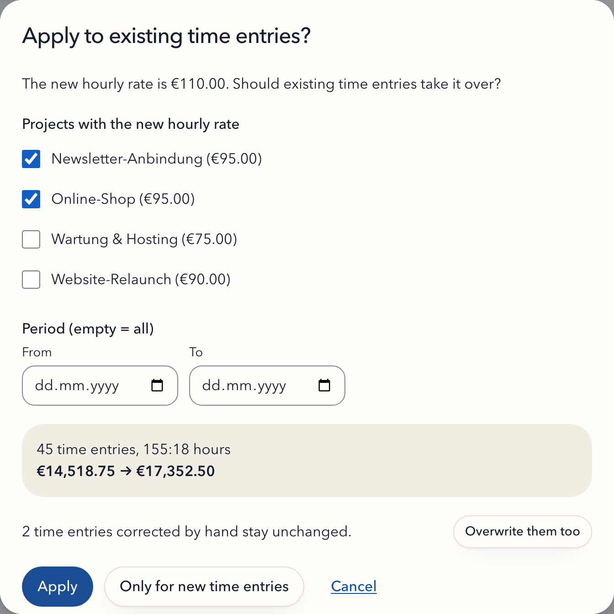
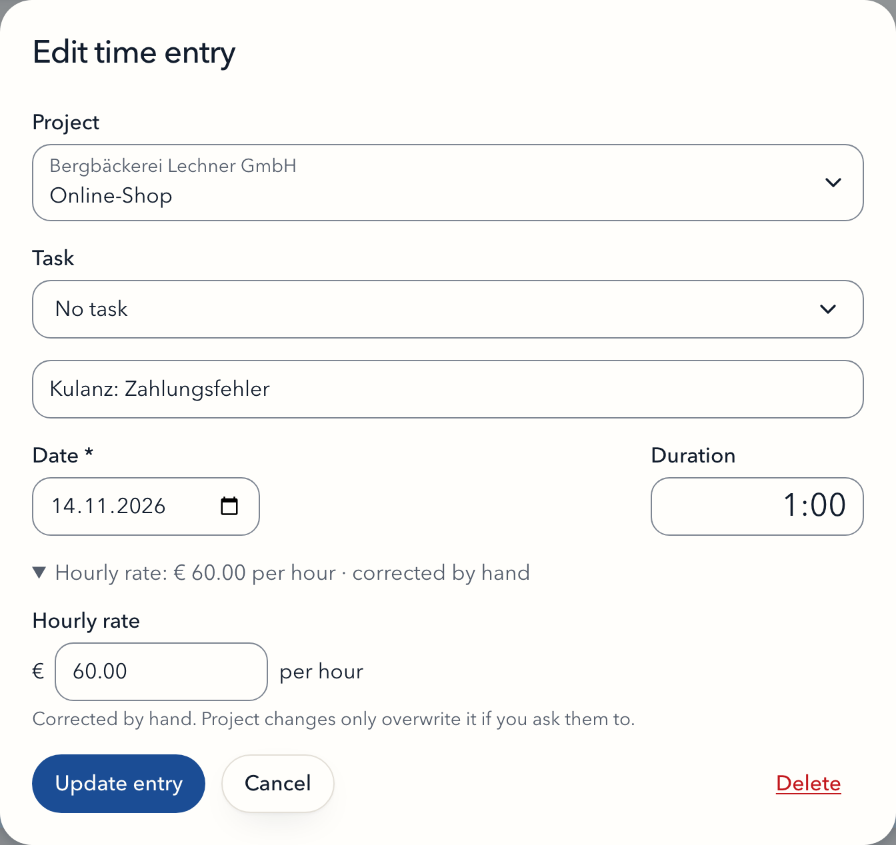

# Hourly rates

## Copied, not inherited

An hourly rate is copied once, when something is created, along this chain:

```
Default hourly rate  →  Customer  →  Project  →  Task (optional)  →  Time entry
   (Settings)          on create    on create    own rate or         on create / new timer
                                                 "as project"
```

- A new **customer** starts with the default hourly rate from Settings.
- A new **project** starts with its customer's rate.
- A **task** can have an own rate. Without one it uses its project's current rate, see [Tasks](tasks.md).
- A new **time entry** takes its task's own rate, otherwise its project's rate, when you save it or start a new timer for it.
- A **continued** time entry (▶ on a row) keeps the rate it already has.

Each level can be changed freely afterwards. There is no live link: changing a rate never silently changes anything below it. Instead, Dreck asks.

## Changing the rate of a project

When you change a project's hourly rate and the project has time entries, Dreck asks **Apply to existing time entries?**

- **Period (empty = all):** limit the change to time entries in a date range. Both days count, and either end can be left open. Example: "From 2026-01-01" applies the new rate to this year's entries and keeps last year's.
- **Live preview:** the dialog shows how many entries and hours are affected and the amount before and after.
- **Apply** sets the new rate on the project and on the affected time entries.
- **Only for new time entries** sets the new rate on the project and leaves all existing time entries as they are.

Everything happens in one step: either the rate and all affected entries change, or nothing does.



If the project has no time entries yet, the new rate is saved without the question.

Time entries of a task with an own rate keep their rate when the project rate changes, because their rate comes from the task.

## Changing the rate of a task

Setting, changing or clearing a task's own rate in **Edit project** asks the same question for the time entries of that task. If the project rate and task rates change at once, the dialog covers all affected entries together, each with its new rate.

## Changing the rate of a customer

When you change a customer's hourly rate and the customer has active projects, Dreck asks the same question with one addition: a list of the customer's projects with their current rates. It asks even if those projects have no time entries yet, because you still choose which projects get the new rate. Without active projects, only the customer's rate changes.

- **Preselected** are the projects that still have the customer's old rate. Projects with a rate of their own are not selected, so a negotiated special rate survives a general price increase.
- Every selected project gets the new rate, whichever button you choose.
- **Apply** also applies the project rule above to the selected projects' time entries, with one shared period for all of them.
- **Only for new time entries** leaves all existing time entries as they are. New time entries on the selected projects get the new rate.
- Unselected projects and their time entries stay unchanged. New projects of the customer start with the new rate.

Archived projects are not in the list and never change with the customer. Time entries of tasks with an own rate stay unchanged.



## Changing the default hourly rate

Changing the default hourly rate in Settings affects only customers created afterwards. Existing customers, projects and time entries stay as they are.

## Time entries corrected by hand

**Edit time entry** has a folded **Hourly rate** section below the date; click it to open the field. Changing the rate marks the entry as **corrected by hand**, and the section says so the next time you open the entry. When a project or customer rate is applied to existing entries, these entries are protected:



- The dialog lists them separately: "N time entries corrected by hand stay unchanged."
- **Overwrite them too** includes them. Afterwards they no longer count as corrected.

Through the API the same correction is `PATCH /api/v1/time-entries/:id` with `hourlyRateMinor`.

## Moving a time entry

Moving a time entry to another project gives it the new project's current rate and clears its "corrected by hand" mark. Choosing another task does the same with the task's rate. In the dialog, the rate in the folded section follows the project you pick, so you see the new rate before saving.

If you change the rate field yourself, it no longer follows the project: the entry moves with the rate you entered and counts as corrected. Through the API, sending `projectId` and `hourlyRateMinor` together does the same.

## How amounts are calculated

The amount of a time entry is its rate times its rounded duration:

```
amount = round(hourly rate × rounded seconds / 3600)
```

The result is rounded half up to the smallest unit of the currency (cents for EUR, whole yen for JPY). Totals per project and customer add up these rounded amounts, so the Report and the CSV always match to the cent. See [Reports and rounding](reports.md) for how durations are rounded.
