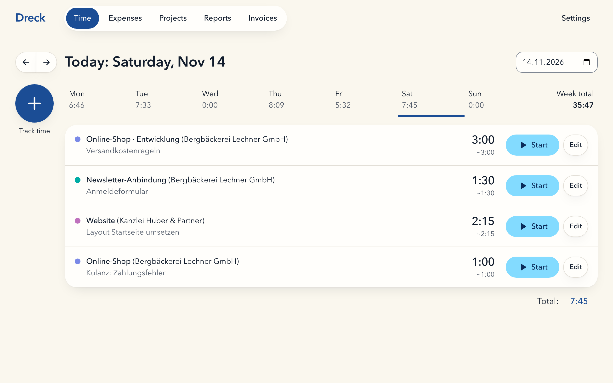
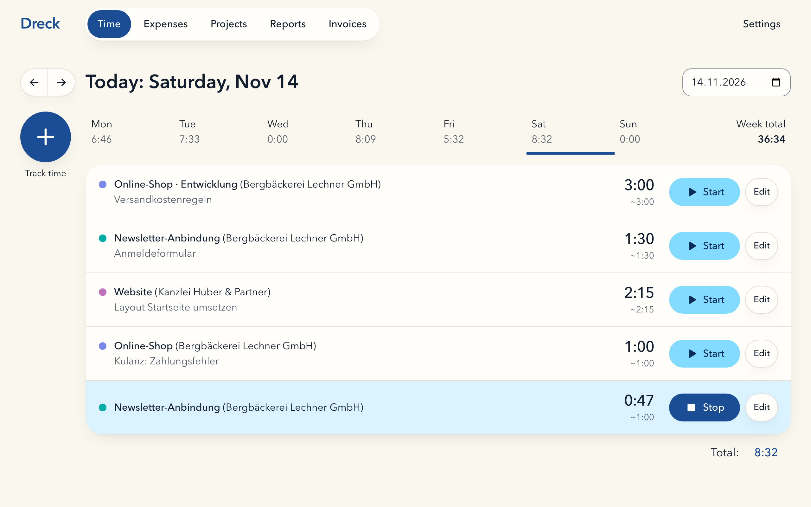
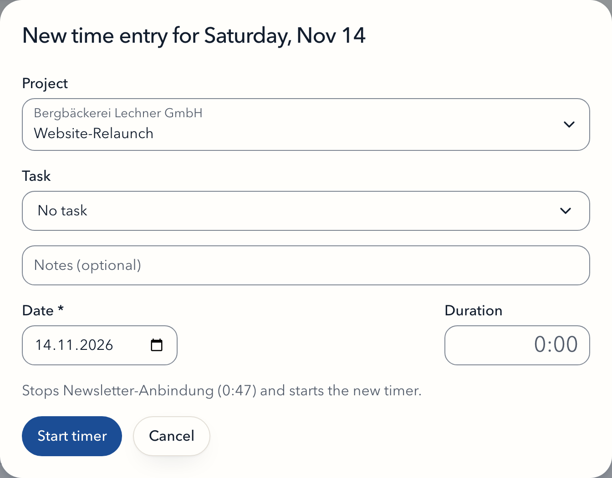
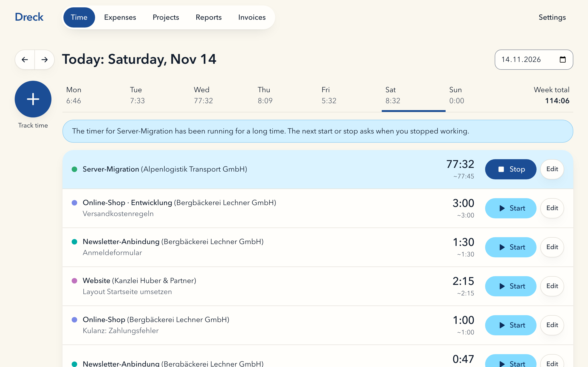
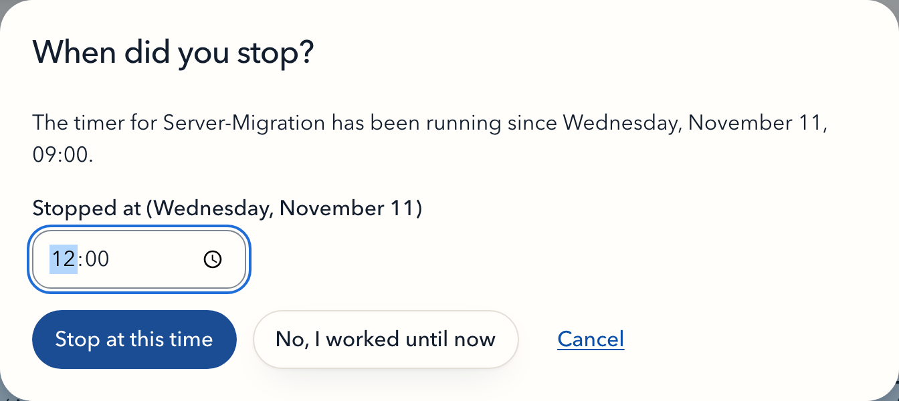
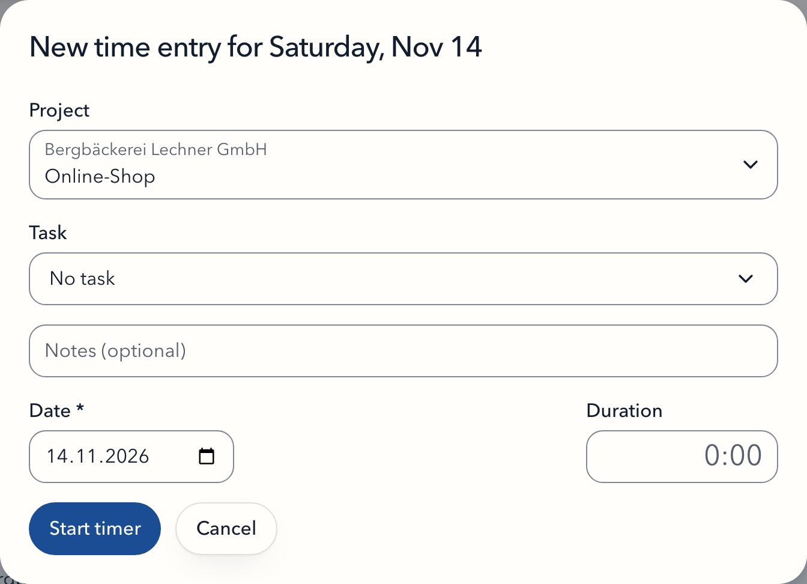
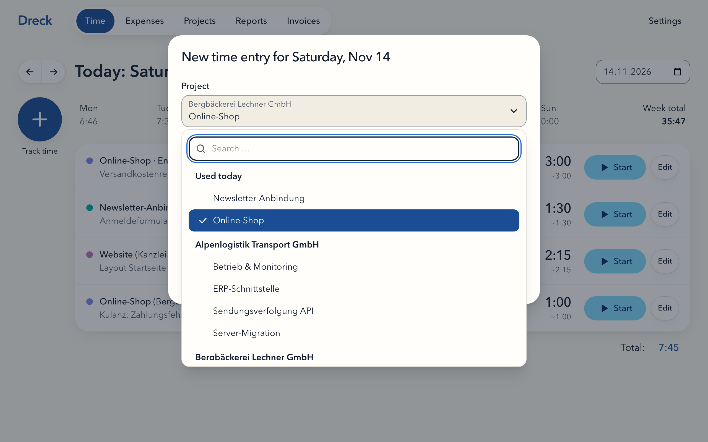
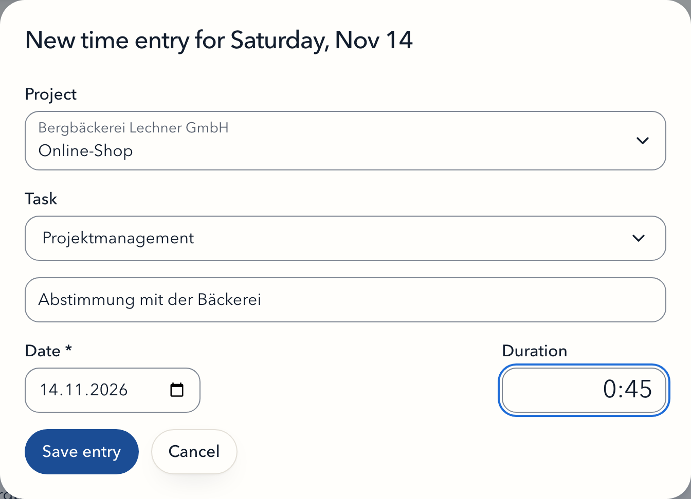
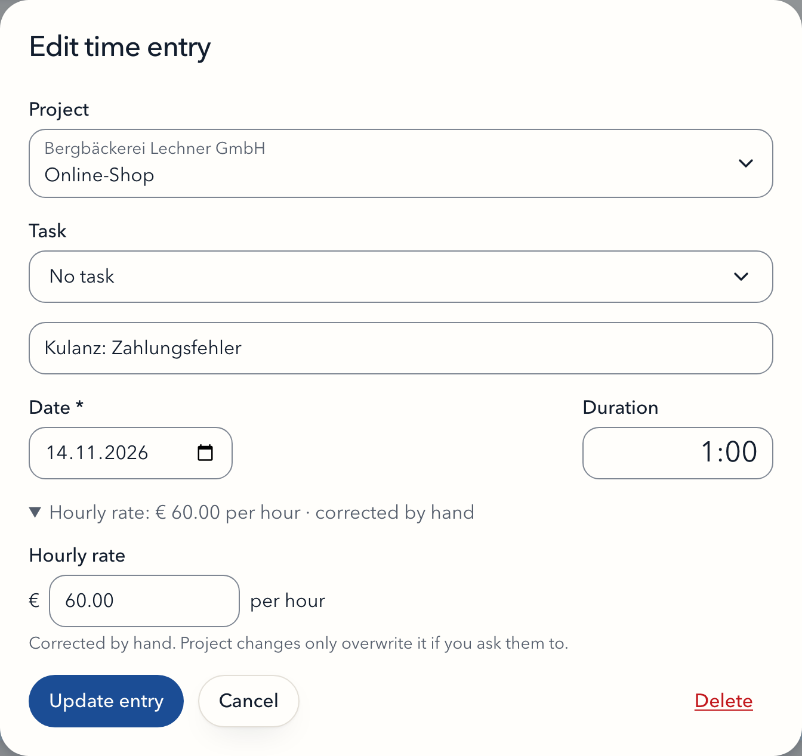

# Tracking time

## Time entries

A time entry is worked time on one project on one calendar day: a date, a duration and an optional description. It has no start or end time, and entries never overlap or conflict.

The **Time** screen shows one day at a time, with the week (Monday to Sunday) above it. Entries of a day appear in the order you created them. If rounding is on, each entry shows its rounded duration below the exact one.

## The timer

A timer is a time entry that is running. Its duration grows until you stop it.

- **At most one timer runs.** Starting a timer stops the running one in the same step. The dialog tells you beforehand: "Stops X (0:47) and starts the new timer."
- **Start a new timer:** **Track time** today, choose a project, leave the duration empty, **Start timer**. The entry gets today's date.
- **Continue an entry:** ▶ on a row continues that entry; its duration keeps growing from where it stopped. Only entries of today have ▶. Entries of earlier days can be edited, not started.
- **No automatic merge:** a new timer on the same project and description creates a second entry. Use ▶ on the existing row if you want one entry.
- **Past midnight:** a timer keeps its start date. Work from 22:00 to 01:00 counts as 3 hours on the first day.
- **"Today"** is the day in the instance time zone from **Settings**, not the device's.
- A timer stopped after a few seconds stays as a 0:00 entry. Delete it if you do not need it.

## Forgotten timers

A timer counts as forgotten when it has run for more than 10 hours or was started on an earlier day. Today's list then shows it on top with a notice, even if it started last week, so you can stop it.

While a timer is forgotten, every start or stop asks **When did you stop?** first:

- Enter the time you stopped working on the day the timer started, and choose **Stop at this time**. The timer ends then, not now. A time before its start is refused.
- **No, I worked until now** keeps the full duration.
- After either answer, the start you asked for (▶ on a row, or **Start timer** in the dialog) runs as usual.
- **Cancel** changes nothing; the timer keeps running.

Dreck does not store the time you enter anywhere else. It only uses it to calculate the duration.

## Durations

Durations are entered as `h:mm` or as decimal hours (comma or dot):

| Input | Duration |
|---|---|
| `2:30` | 2 h 30 min |
| `0:45` | 45 min |
| `2` | 2 h |
| `:45` | 45 min |
| `2,5` / `2.5` | 2 h 30 min |
| `,5` | 30 min |

A plain number means hours, so `90` is 90 hours, not 90 minutes. Decimal hours are rounded to whole minutes (`1,33` = 1:20). Anything else (`2h`, `1:5`, `2,`) is rejected with "Format h:mm or hours, e.g. 2:30 or 2.5". In the dialog a duration must be more than 0:00 and at most 24:00. Durations are shown in whole minutes; seconds are kept and count in reports.

## The dialog

The same dialog creates and edits time entries.

| Situation | Main button | Duration |
|---|---|---|
| New, today, duration empty | **Start timer** | – |
| New, today, with duration | **Save entry** | as entered |
| New, earlier day | **Save entry** | required |
| Edit | **Update entry** | prefilled; hourly rate folded away below |

- **Prefill:** a new entry starts with the project of the running timer, otherwise the project you used last this week, otherwise your only project if there is just one.
- **Project picker:** type to filter. Projects used today come first. Archived projects cannot be picked.

- **Task:** appears once the project has [tasks](tasks.md); optional. Archived tasks cannot be picked.

- **Description suggestions** come from this week's entries of the same project.
- **Editing a running entry:** a new duration sets the total so far, and the timer keeps running from there. Leave the duration as it is to change only project, date or description.
- **Moving an entry to another project** gives it that project's hourly rate, see [Hourly rates](hourly-rates.md#moving-a-time-entry).
- **Hourly rate** (edit only, folded away) corrects the rate of this one entry, see [Hourly rates](hourly-rates.md#time-entries-corrected-by-hand).

